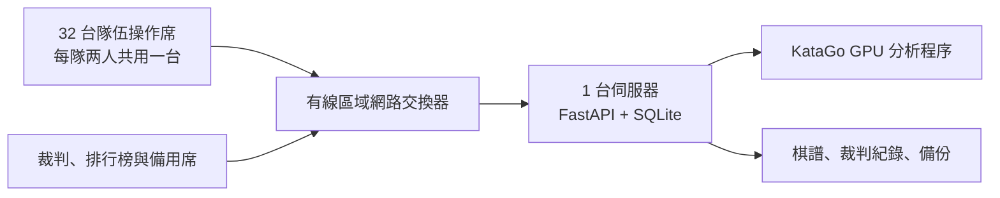

# 2026-10-17 楊海分站賽部署與操作

## 建議架構



50 台電腦指可用設備數量，不代表需要 50 台各自跑 KataGo。32 隊最多同時有 16 場棋局，點棋手席只需 32 台。建議讓主機與操作席使用有線 LAN，避免依賴雲端連線或活動當日的外部網路。模型及程式提前下載後可以離線運作；前端沒有 CDN 依賴。

伺服器需一台可用的 Linux x86_64 主機。GPU 選型要依正式模型、visits 和效能實測決定；目前未取得 50 台電腦的 GPU 型號、OS、網路資料，沒有驗證特定顯示卡或場地。正式賽建議 GPU 集中運算，備一台已安裝相同模型的主機。每個伺服器只能啟一個應用程序／Uvicorn worker，不可對同一資料庫啟多個服務。

## 安裝與啟動

1. 在伺服器準備 Python 3.12／3.13、uv 和完整程式目錄。先執行 `bash scripts/setup.sh` 驗證 CPU 開發流程。
2. 依 NVIDIA 驅動、CUDA／cuDNN 版本取得 [KataGo 官方相容 GPU binary](https://github.com/lightvector/KataGo/releases) 與 [官方訓練模型](https://katagotraining.org/)。驗證官方摘要及 TLS；不以未知來源下載取代。GPU 範例設定需測試後才能定案。
3. 設定 `KATAGO_BIN`、`KATAGO_MODEL`、`KATAGO_CONFIG` 為主機上絕對路徑，`AI_CONCURRENCY` 與 KataGo `numAnalysisThreads` 相符。不要使用勝率觀點不同的設定；系統以行棋方觀點解讀 `winrate`。
4. 首次啟動可用以下指令。以現場固定 IPv4 及網路防火牆設定，允許活動操作席進入 TCP 8000。若不在完全可信任的活動 LAN，需在同一來源的 HTTPS 反向代理後使用；應依代理設定 Uvicorn 的受信任 forwarded headers。不可直接開放管理服務至公網。

```bash
cd /path/to/drevil5678
export KATAGO_BIN=/absolute/path/to/verified/katago
export KATAGO_MODEL=/absolute/path/to/verified/model.bin.gz
export KATAGO_CONFIG=/absolute/path/to/tested/analysis.cfg
export AI_CONCURRENCY=4
HOST=0.0.0.0 PORT=8000 bash scripts/start.sh
```

5. 每台客戶端在瀏覽器使用「伺服器區域網路 IP，連接埠 8000」，例如由現場技術人員提供的實際位址。`0.0.0.0` 是伺服器監聽設定，不是選手要輸入的地址；本文件不提供雲端 localhost 預覽。
6. 確認 `/api/health` 為 `ok: true`、`ai_ready: true`。管理頁仍會要求主辦方確認賽制設定；AI 健康狀態只表示模型可分析，不表示硬體通過正式賽效能驗收。

## 開賽前驗收

使用正式 binary、模型、19 路、正式 visits，以 `scripts/smoke.py --teams 32 --board 19 --visits <正式值>` 重測，程式繼承 `KATAGO_*` 與 `AI_CONCURRENCY`。同時讓 50 台**實際場地電腦**開啟賽場頁，32 台操作席完成至少一輪練習對弈，包含中盤局面和每輪同時落子。

評估 AI 首次及中盤分析的 P95、最慢延遲、GPU 使用量、HTTP 回應、伺服器與交換器負載。建議目標為日常提示在 1 秒內、最慢提示在 2 秒內；這是活動品質目標，非目前已驗證的保證。128 visits 的小模型數字不能拿來推估大型模型／1024 visits 的表現。若太慢，先調整硬體及並行配置，再於全場一致的前提下決定分析預算。

另需測試斷線、伺服器重啟、KataGo 停止、裁判全場暫停、從備份還原、點棋手操作碼混用及瀏覽器重整。預演完畢不要沿用測試名單；正式資料使用新的 `TOURNAMENT_DATA` 目錄，或保留預演目錄後另建正式目錄。要共用預先下載的引擎時，必須保留完整 `KATAGO_*` 路徑。

## 正式規則設定建議

| 項目 | 目前設定／建議 | 依據 |
| --- | --- | --- |
| 棋盤與貼目 | 19 路、黑貼 7.5 目 | 本次建置建議，首輪前可調整 |
| 規則 | 中國規則、位置超劫、禁止自殺手 | 本機與 KataGo `chinese-ogs` 一致 |
| 時間 | 每方 600 秒、不增秒 | 章程；參考自備設備方 300 秒 |
| 禁止落點 | 官方回傳候選中最高原始勝率者 | 主辦方介面以勝率排序；同勝率按 visits、座標決定 |
| 判負 | 第 61 手起，連續三個自身回合最佳可選點勝率 ≤ 40.00% | 主辦方本次明確指定門檻，其餘沿用章程 |
| 判負記分 | 低勝率勝 1.25；超時勝 1；敗 0 | 章程 |
| 分析等待 | 不扣時，提示送達後啟動時間 | 系統政策，需賽前公告 |
| 雙方停一手 | 暫停並交裁判決定勝隊與積分 | 章程未定義，需補充公告 |
| 奇數隊、輪空、和局、認輸 | 目前無自動記分規則 | 主辦方尚未指定；不可臨場默認任意分數 |

7.5 目是常見的中國規則平衡值。40% 改的是提前判負條件，不是黑白的先手平衡，因此不建議為配合 40% 而任意改貼目。正式模型下可分析空棋盤並安排交換黑白的預演局，確認資料沒有勝率觀點反轉。

## 當日工作流程（Asia/Taipei）

- **12:30–13:00**：將既有報名順序整理成 `name,captain,member,captain_points,member_points` CSV 匯入。檢查資格證明後逐隊檢錄。自備設備選項是每場比賽決定，不能只在第一輪登記一次。
- **13:00–13:15**：說明 40% 門檻、貼目、AI 首選判定、分析等待、停一手和裁判終局政策。確認 GPU 效能與規則後在管理頁勾選規則已公告。
- **13:15–15:35**：依序建立六輪瑞士賽。每輪列印操作碼，檢查自備設備選項後逐桌開賽。全部結果完成再產生下一輪；每輪按備份及匯出。
- **15:35–15:50**：核對積分、對手積分和報名順位，再建立八強。積分同分時不要手動覆寫排行。
- **15:50–16:40**：八強、四強單場，各輪完成後建立下一輪。
- **16:40–17:40**：冠軍戰，逐局建立；一方先獲兩勝即結束，無需建立第三局。
- **17:40–18:00**：核對獎金、出場費與火星積分分配，備份及匯出，交由主辦方實際發放。

## 異常與恢復

- 個別或全場網路問題：裁判填寫原因後暫停，排除後逐桌恢復。瀏覽器關閉不自動停時，避免讓選手藉重新整理改變計時。
- KataGo 結束或回應錯誤：系統暫停受影響棋局；KataGo 程序結束時全場進行中的棋局會暫停。修正設定後重啟服務，逐桌確認恢復；不得以模擬勝率代替正式 AI。
- 伺服器重啟：保留棋盤、候選、連續紀錄與最新保存時鐘，忽略停機時間，先暫停等待裁判。突發斷電最多可能回復約一秒前的時鐘資料，仍需裁判核對。
- 主辦方裁定重賽：使用管理頁重賽，原棋譜與時鐘保留在事件記錄，新局重新計時。不要刪除原資料庫來假裝重賽。
- 完整備份位於資料目錄 `backups/`；JSON 匯出用於核對，**不是**可還原的完整備份。資料庫備份含兩方操作碼，不可公開。

還原時先停止本服務、保留現有完整資料目錄，將已驗證的備份複製成**新的**資料目錄下的 `tournament.sqlite3`，再以 `TOURNAMENT_DATA=/new/absolute/path` 和原引擎路徑啟動。新目錄會產生新管理金鑰；每桌重啟後先暫停。SQLite 備份 API 產生的檔案是完整快照；不要在服務運作時直接只複製主資料庫檔而忽略 WAL。

## 網路與發布狀態

CPU 開發安裝只需要已允許的 `pypi.org`、`files.pythonhosted.org`、`github.com` 和 GitHub release-assets 目的地，無需額外秘鑰。若雲端環境日後下載最新模型，可能需要於環境設定另加 `katagotraining.org` 與下載時實際出現的模型主機；目前沒有擴大網路清單。

此次工作只驗證當前雲端實例與保存設定草稿。GitHub 原始儲存庫沒有 commit 或 main 分支，新增程式尚未提交／推送；發布環境會保存準備好的檔案快照，但發布與新任務還原需由產品流程完成和驗證。
